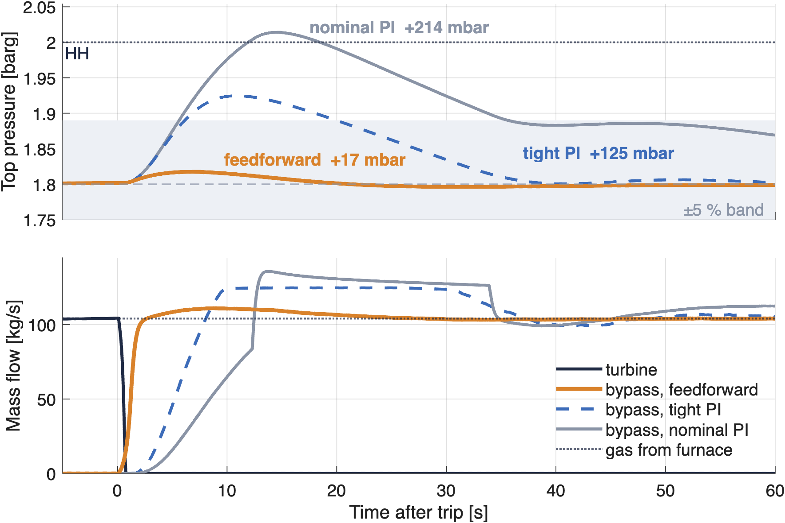

# Blast-Furnace Top-Pressure Control with a Top-Gas Recovery Turbine (TRT)

> **Independent educational project. All parameters are illustrative and based on public literature.**

A Top-gas Recovery Turbine turns the pressure of blast-furnace gas into ≈ 7 MW of electricity.
It must also be **invisible to the furnace**: top pressure has to stay at set point even when the
turbine trips. This project does, at small scale, what a controls engineer does on such a plant.
It covers the design basis, P&ID, control narrative, I/O list and cause & effect, a
physics-based Simulink model, and the control strategy, verified in simulation.



**Key result.** At a full-load trip about 104 kg/s of gas must move from the turbine to the
bypass valves within a second. A **feedforward** opens the bypass straight to the position that
passes the turbine flow, by inverting the ISA-75.01 valve equation. **Output tracking** then
hands over to the PI without a bump. The top-pressure peak is **+17 mbar**, against a target of
90 mbar.

Feedback alone needs the pressure to rise before it can react:

- the nominal PI gives **+214 mbar** and reaches the high-high level;
- the tightest recommended PI (SIMC τc = θ) still gives **+125 mbar**;
- a PI pushed to the target reaches only +90 mbar, with a 20° phase margin.

| Scenario | Peak top-pressure deviation | Notes |
|---|---|---|
| Trip at full load, FF + tracking | **17 mbar** | 7–27 mbar over ESD 0.5–1.0 s and bypass stroke 1–2 s |
| Trip, feedback only (nominal / tight PI) | 214 / 125 mbar | [how far feedback alone can go](simulink/results/kpi_table.md#trip-how-far-can-feedback-alone-go) |
| Blast-flow step ±10 % | 28 mbar | absorbed by the stator vanes, bypass stays closed |
| Furnace slip +30 % for 5 s | 56 mbar | bypass not needed |
| Loading bypass → turbine | 3.5 mbar (58 mbar without transfer FF) | bumpless hand-over to split range |

## Contents

| Path | Content |
|---|---|
| [`docs/02_control_narrative.md`](docs/02_control_narrative.md) | **Key document**: modes, loops, loop assignment per mode, sequences, trips, results |
| [`docs/pid/trt_pid.svg`](docs/pid/trt_pid.svg) | Simplified P&ID (ISA-5.1), generated from `tags.csv` |
| [`docs/03_io_list.md`](docs/03_io_list.md) · [`docs/04_cause_and_effect.md`](docs/04_cause_and_effect.md) | I/O list, alarm list, C&E matrix (also xlsx / csv), generated |
| [`docs/assumptions.md`](docs/assumptions.md) | Every number with its source; design-point consistency check |
| [`docs/safety_note.md`](docs/safety_note.md) | Candidate SIFs (IEC 61511), hypothetical SIL, independence |
| [`simulink/`](simulink) | `params.m`, physics functions, `build_models.m` → `trt_model.slx`, PLC logic `trt_controller_step.m`, `run_scenarios.m` |
| [`TRT_Control_Project_Andrea_Zanelli.pdf`](portfolio/TRT_Control_Project_Andrea_Zanelli.pdf) | 5-page summary |

**Model.** The plant model includes:
- two gas volumes around the cleaning plant;
- the Stodola ellipse law for the turbine;
- ISA-75.01 compressible, choked flow for the bypass;
- a quick-closing ESD;
- a rotor with an explicit breaker switch;
- rate-limited actuators;
- noisy 2oo3 transmitters.

**Control.** The 100 ms PLC logic is one codegen-ready MATLAB file, the source for IEC 61131-3
Structured Text. It contains:
- a split-range PI, tuned by SIMC on the linearised plant;
- back-calculation anti-windup, with external reset during overrides;
- gain scheduling;
- the bypass feedforward with output tracking;
- a loading transfer feedforward;
- sequential breaker tripping.

## How to run

```bash
git clone https://github.com/zano0/trt-top-pressure-control.git && cd trt-top-pressure-control
python3 -m venv .venv && .venv/bin/pip install -r requirements.txt
.venv/bin/python scripts/make_pid.py && .venv/bin/python scripts/make_docs.py && .venv/bin/python scripts/check_tags.py
.venv/bin/python portfolio/build_pdf.py      # needs: .venv/bin/playwright install chromium
```
```matlab
cd simulink
params('report');   % design-point check
run_scenarios       % builds trt_model.slx, runs all scenarios, writes results/ (about 2 min)
```
MATLAB/Simulink R2025a (Control System Toolbox for the stability margins), C compiler for the
MATLAB Function blocks.

## Status

Done: design basis, P&ID, control narrative, I/O list, C&E, safety note, Simulink model and
control (scenarios 1–4). Next: IEC 61131-3 ST on OpenPLC with Software-in-the-Loop via Modbus
and HMI, then MPC on a 24 h disturbance profile, then the virtual commissioning protocol.
